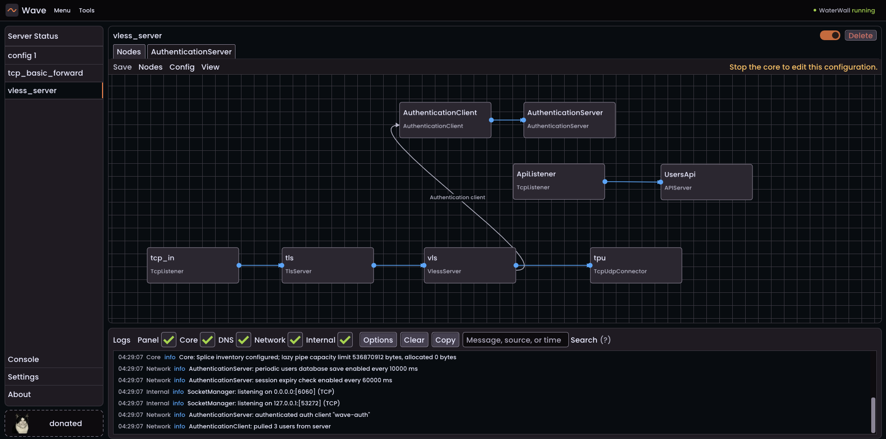
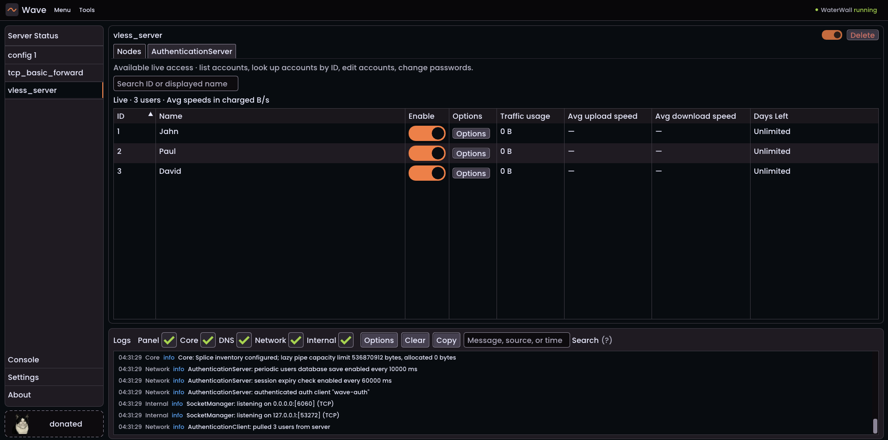
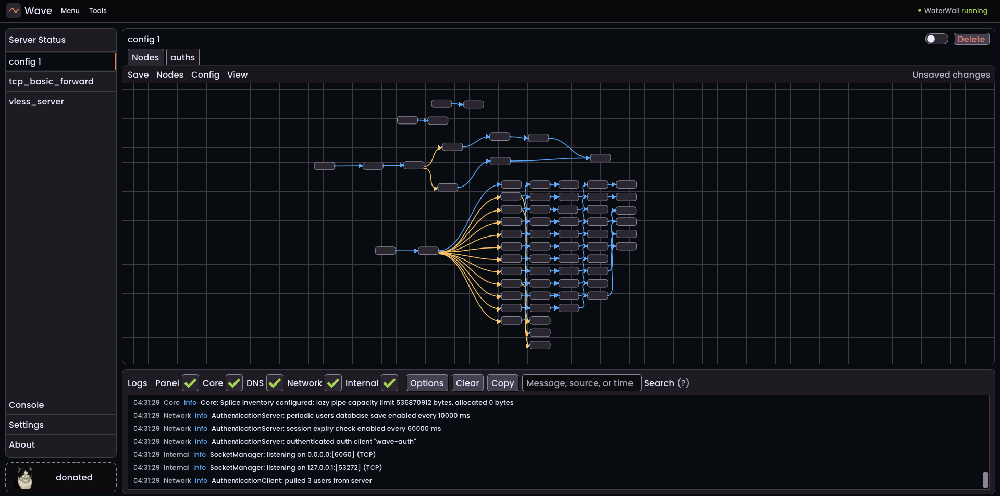
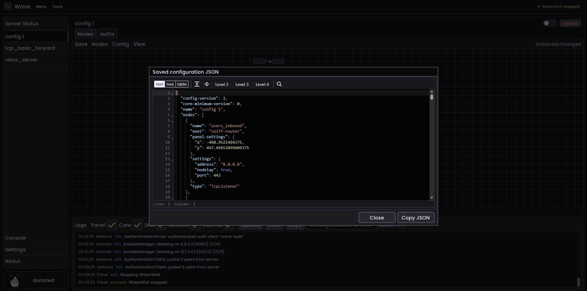
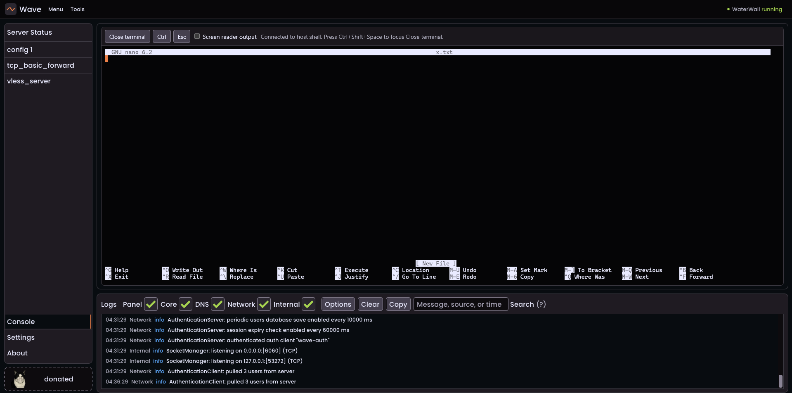
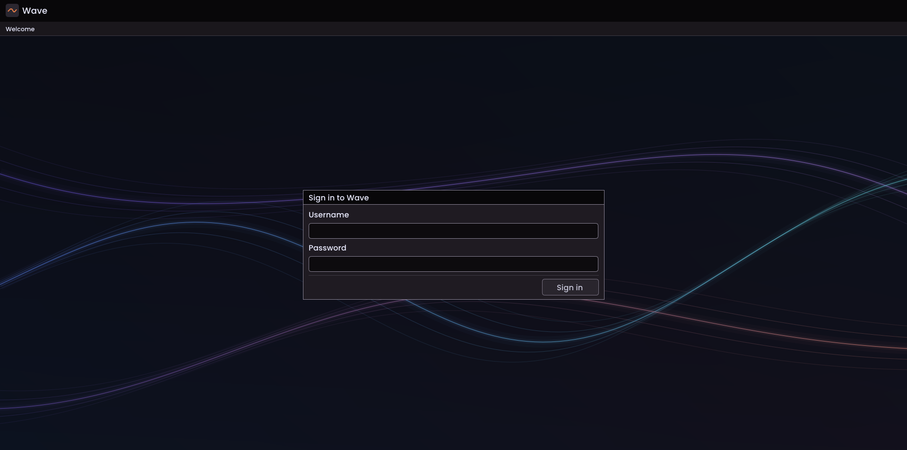

# Wave

Wave is a web panel for configuring and managing WaterWall on Linux.

## Install

Run this in a terminal as your regular user. Wave publishes packages for Linux x86-64 and ARM64.

```bash
( installer=$(mktemp) && trap 'rm -f -- "$installer"' EXIT && curl -q --proto '=https' --proto-redir '=https' -fsSL https://raw.githubusercontent.com/radkesvat/wave/main/scripts/install.sh -o "$installer" && bash "$installer" )
```

The installer asks for a version, directory, and port. Run `wave` to manage the
first instance or `wave2` for the second. Start with the setup URL printed by
the installer. Each instance is enabled as a systemd service and starts after
a reboot.

- [Installation and management](doc/installing.md)
- [Build from source](doc/building.md)

## Screenshots

**VLESS configuration**



**User management**



**Configuration graph**



**Saved configuration JSON**



**Browser console**



**Sign-in**


